# CLASH OF BYTES – 2D LOCAL MULTIPLAYER FIGHTING GAME
## JAVA SWING DATABASE AUTHENTICATION & MATCH HISTORY ARCHITECTURE REPORT
### Examination Reform Guidelines – Semester III (Academic Year 2026–2027)
**Department of Computer Engineering, MIT Academy of Engineering, Alandi (Pune)**

---

## 📋 EXECUTIVE SUMMARY

A relational database-connected **Two-Player Authentication, Character Selection, Player Statistics Dashboard, and Match History System** has been engineered and integrated into the **Clash of Bytes** fighting game.

### Core System Features:
1. **Dual Independent Player Authentication**: Side-by-side authentication panels for Player 1 (Cyan Stance) and Player 2 (Magenta Stance) on the **same screen**, with independent Login and Sign Up dialogs.
2. **Account Collision Guard**: Strictly prevents identical accounts from playing against each other in the same match ($P_1 \neq P_2$).
3. **Cryptographic Password Security**: Passwords are never stored in plain-text. Passwords are salted with a 16-byte cryptographically secure random salt (`SecureRandom`) and hashed with 1,000 iterations of SHA-256 stretching.
4. **Relational Database Design**: 5 normalized tables (`users`, `characters`, `matches`, `match_players`, `match_rounds`) with foreign keys, cascading integrity, check constraints, and performance indexes.
5. **Atomic Transactional Match Persistence**: Every completed match commits the master `matches` record, exactly two `match_players` records, and individual `match_rounds` records within a single atomic database transaction (`conn.setAutoCommit(false)` / `conn.commit()`), rolling back cleanly on any constraint violation.
6. **Player Career Dashboard & Telemetry Archive**: Career statistics (wins, losses, draws, win rate %, total accumulated score, favorite character) and an interactive Cyberpunk `JTable` match history viewer.
7. **Zero-Configuration SQLite + PostgreSQL Compatibility**: Self-contained SQLite database (`clash_of_bytes.db`) with zero external server dependencies, with full plug-and-play support for PostgreSQL via `db.properties`.

---

## 1. SYSTEM ARCHITECTURE & DATA FLOW

```mermaid
classDiagram
    class DBConnection {
        -String dbUrl
        -Connection connection
        +getConnection() Connection
        +closeConnection() void
    }

    class DatabaseInitializer {
        +initializeDatabase() void
        -seedCharacters(Connection conn) void
    }

    class User {
        -int userId
        -String username
        -String email
        -String passwordHash
        -String salt
        -Timestamp createdAt
        +getters() / setters()
    }

    class Character {
        -int characterId
        -String characterName
        -String archetype
        -double baseHp
        -double baseAttack
        -double baseDefense
        -double speed
    }

    class Match {
        -int matchId
        -Timestamp matchDate
        -int player1UserId
        -int player2UserId
        -Integer winnerUserId
        -int totalRounds
        -String matchStatus
        -int player1FinalScore
        -int player2FinalScore
    }

    class MatchPlayer {
        -int matchPlayerId
        -int matchId
        -int userId
        -int characterId
        -int finalScore
        -String result
    }

    class MatchRound {
        -int roundId
        -int matchId
        -int roundNumber
        -Integer winnerUserId
        -int player1Score
        -int player2Score
        -String roundStatus
    }

    class UserDAO {
        +createUser(User) User
        +getUserByUsername(String) User
        +getUserByEmail(String) User
        +getUserById(int) User
        +isUsernameTaken(String) boolean
        +isEmailTaken(String) boolean
    }

    class CharacterDAO {
        +getAllCharacters() List~Character~
        +getCharacterById(int) Character
        +getCharacterByName(String) Character
    }

    class MatchDAO {
        +saveMatchComplete(Match, MatchPlayer, MatchPlayer, List~MatchRound~) boolean
        +getMatchById(int) Match
        +getPlayersForMatch(int) List~MatchPlayer~
        +getRoundsForMatch(int) List~MatchRound~
    }

    class StatisticsDAO {
        +getPlayerStats(int userId) PlayerStats
        +getMatchHistoryForUser(int userId) List~MatchHistoryRow~
    }

    class AuthService {
        +registerUser(username, email, password) User
        +authenticateUser(identifier, password) User
        +hashPassword(password, salt) String
        +generateSalt() String
    }

    class MatchService {
        +recordMatchResult(...) boolean
    }

    class StatisticsService {
        +getPlayerStats(userId) PlayerStats
        +getMatchHistoryForUser(userId) List~MatchHistoryRow~
    }

    AuthService --> UserDAO
    MatchService --> MatchDAO
    StatisticsService --> StatisticsDAO
    UserDAO --> DBConnection
    CharacterDAO --> DBConnection
    MatchDAO --> DBConnection
    StatisticsDAO --> DBConnection
    DatabaseInitializer --> DBConnection
```



---

## 2. DATABASE RELATIONAL SCHEMA (`scripts/schema.sql`)

```sql
-- 1. USERS TABLE
CREATE TABLE IF NOT EXISTS users (
    user_id INTEGER PRIMARY KEY AUTOINCREMENT,
    username VARCHAR(50) NOT NULL UNIQUE,
    email VARCHAR(100) NOT NULL UNIQUE,
    password_hash VARCHAR(128) NOT NULL,
    salt VARCHAR(64) NOT NULL,
    created_at TIMESTAMP DEFAULT CURRENT_TIMESTAMP
);

-- 2. CHARACTERS TABLE
CREATE TABLE IF NOT EXISTS characters (
    character_id INTEGER PRIMARY KEY AUTOINCREMENT,
    character_name VARCHAR(50) NOT NULL UNIQUE,
    character_description VARCHAR(255) NOT NULL,
    archetype VARCHAR(50) NOT NULL,
    base_hp REAL NOT NULL,
    base_attack REAL NOT NULL,
    base_defense REAL NOT NULL,
    speed REAL NOT NULL
);

-- 3. MATCHES TABLE
CREATE TABLE IF NOT EXISTS matches (
    match_id INTEGER PRIMARY KEY AUTOINCREMENT,
    match_date TIMESTAMP DEFAULT CURRENT_TIMESTAMP,
    player1_user_id INTEGER NOT NULL,
    player2_user_id INTEGER NOT NULL,
    winner_user_id INTEGER,
    total_rounds INTEGER NOT NULL,
    match_status VARCHAR(20) NOT NULL DEFAULT 'COMPLETED',
    player1_final_score INTEGER NOT NULL,
    player2_final_score INTEGER NOT NULL,
    FOREIGN KEY (player1_user_id) REFERENCES users(user_id) ON DELETE CASCADE,
    FOREIGN KEY (player2_user_id) REFERENCES users(user_id) ON DELETE CASCADE,
    FOREIGN KEY (winner_user_id) REFERENCES users(user_id) ON DELETE SET NULL
);

-- 4. MATCH_PLAYERS TABLE (Exactly Two Records Per Match)
CREATE TABLE IF NOT EXISTS match_players (
    match_player_id INTEGER PRIMARY KEY AUTOINCREMENT,
    match_id INTEGER NOT NULL,
    user_id INTEGER NOT NULL,
    character_id INTEGER NOT NULL,
    final_score INTEGER NOT NULL,
    result VARCHAR(10) NOT NULL, -- WIN, LOSS, DRAW
    FOREIGN KEY (match_id) REFERENCES matches(match_id) ON DELETE CASCADE,
    FOREIGN KEY (user_id) REFERENCES users(user_id) ON DELETE CASCADE,
    FOREIGN KEY (character_id) REFERENCES characters(character_id) ON DELETE CASCADE,
    CONSTRAINT chk_match_result CHECK (result IN ('WIN', 'LOSS', 'DRAW'))
);

-- 5. MATCH_ROUNDS TABLE
CREATE TABLE IF NOT EXISTS match_rounds (
    round_id INTEGER PRIMARY KEY AUTOINCREMENT,
    match_id INTEGER NOT NULL,
    round_number INTEGER NOT NULL,
    winner_user_id INTEGER,
    player1_score INTEGER NOT NULL,
    player2_score INTEGER NOT NULL,
    round_status VARCHAR(20) NOT NULL DEFAULT 'COMPLETED',
    FOREIGN KEY (match_id) REFERENCES matches(match_id) ON DELETE CASCADE,
    FOREIGN KEY (winner_user_id) REFERENCES users(user_id) ON DELETE SET NULL
);

-- INDEXES
CREATE INDEX IF NOT EXISTS idx_users_username ON users(username);
CREATE INDEX IF NOT EXISTS idx_users_email ON users(email);
CREATE INDEX IF NOT EXISTS idx_matches_p1 ON matches(player1_user_id);
CREATE INDEX IF NOT EXISTS idx_matches_p2 ON matches(player2_user_id);
CREATE INDEX IF NOT EXISTS idx_match_players_match ON match_players(match_id);
CREATE INDEX IF NOT EXISTS idx_match_players_user ON match_players(user_id);
```

---

## 3. ACTUAL DATABASE QUERY OUTPUTS (VERIFIED FROM `clash_of_bytes.db`)

The following live records were queried directly from the SQLite database via `testing.DumpDatabase`:

```text
=== USERS TABLE ===
User #1: shadow_master_9698   | shadow9698@clashofbytes.edu  | Created: 2026-11-16 17:39:49
User #2: blaze_warrior_9698   | blaze9698@clashofbytes.edu   | Created: 2026-11-16 17:39:49

=== CHARACTERS TABLE (6 Fighters) ===
Char #1: Ironclad Warrior   | WarriorFighter   | HP: 115.0 | ATK: 18.0 | SPD: 5.0
Char #2: Blaze Berserker    | BerserkerWarrior | HP: 130.0 | ATK: 22.0 | SPD: 6.5
Char #3: Shadow Ninja       | NinjaFighter     | HP:  95.0 | ATK: 16.0 | SPD: 9.0
Char #4: Cyber Brawler      | CyberBrawler     | HP: 110.0 | ATK: 19.0 | SPD: 7.0
Char #5: Aura Paladin       | PaladinFighter   | HP: 120.0 | ATK: 17.0 | SPD: 4.5
Char #6: Titan Gladiator    | HybridGladiator  | HP: 140.0 | ATK: 24.0 | SPD: 4.0

=== MATCHES TABLE ===
Match #1 [2026-11-16 17:39:49]: P1(User 1) Score: 220 vs P2(User 2) Score: 195 | Winner: User 1 | Rounds: 3 [COMPLETED]

=== MATCH_PLAYERS TABLE (2 Records Per Match) ===
MP #1 | Match #1 | User: 1 | Char: 1 | Score: 220 | Result: WIN
MP #2 | Match #1 | User: 2 | Char: 3 | Score: 195 | Result: LOSS

=== MATCH_ROUNDS TABLE ===
Round #1 (Match 1, R1) -> Winner: User 1 | P1: 85 pts vs P2: 45 pts [COMPLETED]
Round #2 (Match 1, R2) -> Winner: User 2 | P1: 40 pts vs P2: 90 pts [COMPLETED]
Round #3 (Match 1, R3) -> Winner: User 1 | P1: 95 pts vs P2: 60 pts [COMPLETED]
```

---

## 4. JAVA SWING USER INTERFACE SCREENS & VISUAL PROOF

All four screens have been rendered and captured directly from the Java Swing UI:

| Screen Name | Output Artifact File | Description & Key Features |
| :--- | :--- | :--- |
| **Two-Player Dual Login** | [screenshot_ui_login.png](file:///c:/Users/Varsharani/Downloads/2ND%20YEAR/FightingGame/clash_of_bytes_milestone1_task3%20new/Clash_Of_Bytes/screenshot_ui_login.png) | Side-by-side independent authentication cards for Player 1 (Cyan) and Player 2 (Magenta) with instant validation. |
| **Character Select Arena** | [screenshot_ui_character_select.png](file:///c:/Users/Varsharani/Downloads/2ND%20YEAR/FightingGame/clash_of_bytes_milestone1_task3%20new/Clash_Of_Bytes/screenshot_ui_character_select.png) | Interactive fighter selection with real-time HP/ATK/DEF/Speed progress bars, combat tactics, and round selectors. |
| **Player Career Dashboard** | [screenshot_ui_player_dashboard.png](file:///c:/Users/Varsharani/Downloads/2ND%20YEAR/FightingGame/clash_of_bytes_milestone1_task3%20new/Clash_Of_Bytes/screenshot_ui_player_dashboard.png) | Career metrics: Total Matches, Wins, Losses, Draws, Win Ratio %, Accumulated Score, and Favorite Fighter. |
| **Match Telemetry History** | [screenshot_ui_match_history.png](file:///c:/Users/Varsharani/Downloads/2ND%20YEAR/FightingGame/clash_of_bytes_milestone1_task3%20new/Clash_Of_Bytes/screenshot_ui_match_history.png) | Stylized `JTable` with color-coded WIN (Green) / LOSS (Red) / DRAW badges and full round telemetry. |

---

## 5. AUTOMATED TEST SUITE REPORT (16 / 16 PASSED - 100%)

The complete test suite (`testing.DatabaseAuthTestSuite`) was executed against the database:

```text
========================================================================================
   CLASH OF BYTES: DATABASE AUTHENTICATION & MATCH HISTORY TEST SUITE   
   Course: Problem Solving Using OOP (Java) + Relational Database Architecture          
========================================================================================
[*] Database Schema Initialized at: jdbc:sqlite:clash_of_bytes.db
  [PASS] Test 01: Register Player 1                             | User ID: 1, Username: shadow_master_9698
  [PASS] Test 02: Register Player 2                             | User ID: 2, Username: blaze_warrior_9698
  [PASS] Test 03: Independent Login for Both Players            | P1 verified by username; P2 verified by email
  [PASS] Test 04: Reject Invalid Password                       | Rejected incorrect password attempt with authentication error
  [PASS] Test 05: Reject Duplicate Registrations                | Caught duplicate username collision & duplicate email collision
  [PASS] Test 06: Prevent Self-Match (P1 == P2)                 | Successfully guarded against player 1 playing against self
  [PASS] Test 07: Select Valid Distinct Characters              | Characters loaded: 6 | P1: Ironclad Warrior, P2: Shadow Ninja
  [PASS] Test 08: Simulate Match Rounds                         | Rounds: 3 | P1 Score: 220 | P2 Score: 195
  [PASS] Test 09: Complete Match Transactional Save             | Match, 2 MatchPlayers, and 3 Rounds committed atomically
  [PASS] Test 10: Verify Stored Final Scores                    | Match #1 -> P1 Score: 220, P2 Score: 195
  [PASS] Test 11: Winner & Result Calculation                   | P1 Result: WIN | P2 Result: LOSS | Winner: shadow_master_9698
  [PASS] Test 12: Individual Round Telemetry Stored             | Retrieved 3 rounds with exact round-level scores
  [PASS] Test 13: Character Selections Persisted                | P1 Pick: Ironclad Warrior vs P2 Pick: Shadow Ninja
  [PASS] Test 14: Player Career Stats Aggregation               | P1 WinRate: 100.0%, Total Score: 220, Fav: Ironclad Warrior (1 picks)
  [PASS] Test 15: Data Persistence Across DB Reconnect          | Connection re-established cleanly; user account and history intact
[MatchDAO] Transaction rolled back due to error: [SQLITE_CONSTRAINT_FOREIGNKEY] A foreign key constraint failed
  [PASS] Test 16: Transaction Rollback on DB Error              | Corrupt match safely rolled back; table row count unchanged (1 == 1)

========================================================================================
   TEST RESULTS: 16 / 16 TESTS PASSED (100.0% SUCCESS)
   DATABASE AUTHENTICATION & MATCH HISTORY VERIFICATION COMPLETE!
========================================================================================
```

---

## 6. EXPLANATION OF NEW JAVA CLASSES

| Class | Package | Architecture Role & Responsibilities |
| :--- | :--- | :--- |
| `DBConnection` | `database` | Enterprise JDBC Connection Factory supporting SQLite (`clash_of_bytes.db`) by default with optional external PostgreSQL/MySQL support via `db.properties`. Configures foreign key constraints (`PRAGMA foreign_keys = ON`). |
| `DatabaseInitializer` | `database` | Auto-creates tables, unique constraints, and indexes upon application launch. Pre-populates the 6 standard fighter classes into the `characters` table if empty. |
| `User` | `model` | Entity model encapsulating user account attributes (`userId`, `username`, `email`, `passwordHash`, `salt`, `createdAt`). |
| `Character` | `model` | Entity model representing selectable fighter archetypes, stats, and tactical descriptions. |
| `Match` | `model` | Entity model representing a completed combat match header. |
| `MatchPlayer` | `model` | Junction model binding a user, their chosen fighter, their final points, and their match result (`WIN`, `LOSS`, `DRAW`). |
| `MatchRound` | `model` | Entity model capturing round-by-round point progression, winner, and round status. |
| `PlayerStats` | `model` | Aggregated career telemetry data transfer object for player dashboard rendering. |
| `UserDAO` | `dao` | Handles prepared SQL operations for registration, credentials lookup, and username/email collision checks. |
| `CharacterDAO` | `dao` | Retrieves character rosters, fighter metadata, and individual archetype lookups. |
| `MatchDAO` | `dao` | Implements **atomic database transactions**: inserts match, 2 player records, and all round records within `conn.setAutoCommit(false)` and rolls back on any error. |
| `StatisticsDAO` | `dao` | Runs aggregate SQL queries for career stats and joins match tables for `JTable` history display. |
| `AuthService` | `service` | Validates regex patterns (username, email, password strength) and performs cryptographic salting and SHA-256 stretched password hashing. |
| `MatchService` | `service` | Business logic for winner determination, point summation, and transactional match dispatch. |
| `StatisticsService` | `service` | Business service exposing aggregated player stats and match history rows. |
| `TwoPlayerLoginFrame` | `ui` | Side-by-side Dual Login Window with independent login and sign-up dialogs, asynchronous `SwingWorker` queries, and account collision prevention. |
| `CharacterSelectionFrame` | `ui` | Character Selection Arena displaying archetype stat progress bars, real-time match execution, and dashboard navigation. |
| `PlayerDashboardFrame` | `ui` | Career dashboard displaying wins, losses, win rate %, total accumulated score, and favorite character card. |
| `MatchHistoryFrame` | `ui` | Cyberpunk `JTable` rendering historical combat logs with custom color-coded cell renderers. |
| `DatabaseAuthTestSuite` | `testing` | End-to-end automated verification runner testing all 16 authentication and database test cases. |
| `DumpDatabase` | `testing` | CLI utility printing live relational table contents for examiner verification. |
| `CaptureUIScreenshots` | `testing` | Automated frame renderer capturing high-definition PNG screenshots directly from the Java Swing UI. |

---

## 7. EXECUTION & DEMONSTRATION INSTRUCTIONS

### Option A: Launching the Database GUI Directly (Recommended)
Double-click or run:
```cmd
.\run_db_gui.bat
```
This launches the **Two-Player Database Authentication Window** directly on your desktop.

### Option B: Launching via Master Combat Manager
Run:
```cmd
.\run_java.bat
```
Select **Option [8]**:
```text
[8] Open Database Two-Player Login & Match History System (Swing / JDBC)
```

### Option C: Running the Automated 16-Test Suite
Run:
```cmd
java -cp "4_Object_Oriented_Programming_Java\bin;4_Object_Oriented_Programming_Java\lib\*" testing.DatabaseAuthTestSuite
```

### Option D: Inspecting Database Records via Terminal
Run:
```cmd
java -cp "4_Object_Oriented_Programming_Java\bin;4_Object_Oriented_Programming_Java\lib\*" testing.DumpDatabase
```
