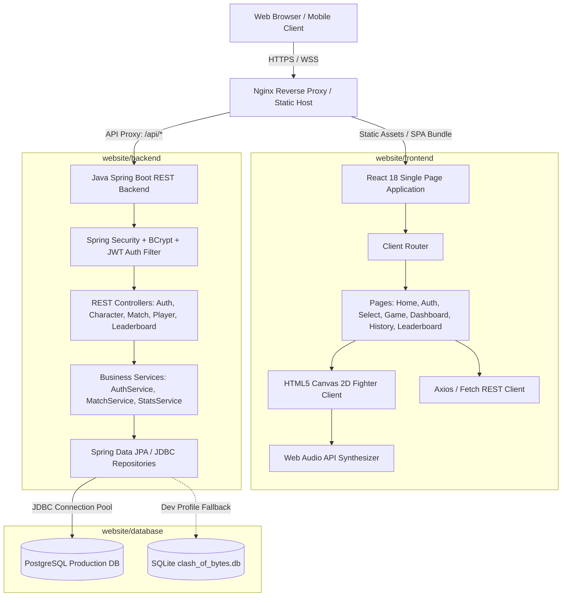

# CLASH OF BYTES: FULL-STACK WEB PLATFORM ARCHITECTURE
**Document Version:** 1.0.0  
**Project:** Clash of Bytes – 2D Local Multiplayer Fighting Game  
**Author:** Principal Full-Stack Architect  
**Scope:** Complete Architectural Specification for Public Production Web Deployment  

---

## 1. High-Level System Architecture

---

## 2. Frontend Architecture (`website/frontend`)

### 2.1 Technology Stack
- **Framework:** React 18+ (SPA)
- **Tooling:** Vite for lightning-fast HMR and optimized production bundling
- **Styling:** Cyberpunk Dark Theme (Pure CSS / Styled Modules):
  - Primary Background: `#080c14` (Deep Cyber Void)
  - Surface Panel: `#0f172a` (Neon Dark Slate)
  - Cyan Accent: `#00e5ff` (Nanotech Glow)
  - Magenta Accent: `#ff2a6d` (Laser Fury)
  - Gold Accent: `#ffcc00` (Champion Gold)
  - Success Green: `#00ff88` (Aegis Shield)
- **Typography:** Orbitron / Rajdhani / Inter (Tech-Display fighting game aesthetics)
- **Audio Engine:** Web Audio API procedural synthesis (retro 80s arcade hit, block, slash, victory sounds)

### 2.2 Component Hierarchy & Routing
- `/` - **HomePage**: Hero section, animated cyberpunk call to action, live character carousel, feature highlights, quick play launcher.
- `/login` - **LoginPage**: Two-player authentication interface or single-player sign-in, session storage, form validation.
- `/register` - **RegisterPage**: Account creation with real-time password strength meter and duplicate checking.
- `/select` - **CharacterSelectionPage**: 6-fighter roster grid with interactive stats radar, move descriptions, P1/P2 selection cards, match configuration.
- `/play` - **GamePage**: 60 FPS HTML5 Canvas battle arena, Gouraud-inspired health bars, combo counters, audio toggle, and automatic match result sync.
- `/dashboard` - **PlayerDashboardPage**: Career overview (total matches, win rate %, favorite fighter, recent match cards).
- `/history` - **MatchHistoryPage**: Rich tabular match history with filtering, search, pagination, and round detail modal.
- `/leaderboard` - **LeaderboardPage**: Global player rankings by wins, win percentage, and total score.

---

## 3. Backend Architecture (`website/backend`)

### 3.1 Technology Stack
- **Language:** Java 17 / 21 / 27
- **Framework:** Spring Boot 3.x
- **Core Modules:**
  - `spring-boot-starter-web`: High-performance REST controllers and JSON serialization.
  - `spring-boot-starter-security`: Authentication filter chain, CORS configuration, CSRF handling.
  - `spring-boot-starter-data-jpa`: Object-relational mapping and entity lifecycle management.
  - `spring-boot-starter-validation`: Declarative request payload validation (`@NotBlank`, `@Email`, `@Size`, `@Min`).
  - `postgresql`: Production JDBC driver.
  - `sqlite-jdbc`: Backward-compatible local database driver.
  - `bcrypt`: Cryptographic password hashing (strength: 12 rounds).

### 3.2 Layered System Design
1. **Controller Layer (`com.clashofbytes.controller`)**:
   - `AuthController`: Handles `/api/auth/register`, `/api/auth/login`, `/api/auth/me`.
   - `CharacterController`: Handles `/api/characters`, `/api/characters/{id}`.
   - `MatchController`: Handles `POST /api/matches` (transactional commit), `GET /api/matches`, `GET /api/matches/{id}`.
   - `PlayerController`: Handles `GET /api/players/{id}/stats`, `GET /api/players/{id}/matches`.
   - `LeaderboardController`: Handles `GET /api/leaderboard`.
2. **Service Layer (`com.clashofbytes.service`)**:
   - `AuthService`: Validates credentials, executes BCrypt password hashing, prevents username/email collision, manages JWT/token sessions.
   - `MatchService`: Validates match consistency (P1 != P2, total rounds, winner ID corresponds to highest score), commits match, match_players, and match_rounds in an atomic `@Transactional` block.
   - `StatisticsService`: Aggregates player career records, calculates win rates and favorite fighters.
3. **Repository Layer (`com.clashofbytes.repository`)**:
   - `UserRepository`, `CharacterRepository`, `MatchRepository`, `MatchPlayerRepository`, `MatchRoundRepository`.
4. **Entity Model (`com.clashofbytes.entity`)**:
   - JPA entities matching the relational database schema.

---

## 4. Database Architecture (`website/database`)

### 4.1 Relational Schema
- **`users`**: User identity, unique username, unique email, BCrypt password hash, creation timestamp.
- **`characters`**: Canonical roster of 6 fighters with base stats (HP, Attack, Defense, Speed).
- **`matches`**: Top-level match metadata, players, winner, total rounds, final scores, timestamp.
- **`match_players`**: Junction table recording per-player performance in each match (character chosen, score, WIN/LOSS/DRAW).
- **`match_rounds`**: Telemetry table storing individual round scores and winner.

### 4.2 Security & Integrity Constraints
- Foreign keys with `ON DELETE CASCADE` ensuring referential integrity.
- Check constraint on `result` (`'WIN'`, `'LOSS'`, `'DRAW'`).
- Unique indexes on `users(username)` and `users(email)`.
- Performance indexes on player foreign keys and match timestamps.

---

## 5. Security & Protection Guidelines
1. **Password Protection**: BCrypt algorithm with cost factor 12. Plaintext passwords or salts are never stored or exposed in API responses.
2. **SQL Injection Prevention**: All queries execute exclusively via Spring Data JPA or `PreparedStatement` parameters.
3. **Cross-Origin Resource Sharing (CORS)**: Strict whitelist allowing only the authorized frontend origin.
4. **Input Sanitization**: Server-side validation rejecting invalid usernames, malformed emails, and invalid match scores.
